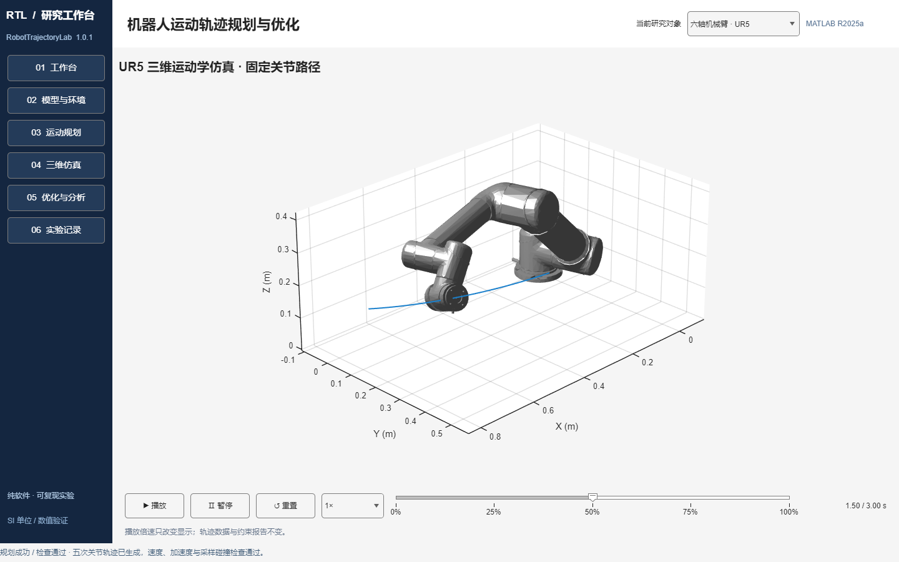
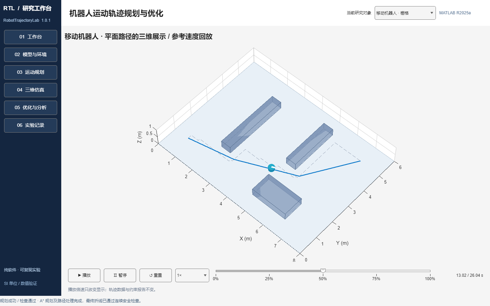

# RobotTrajectoryLab

基于 MATLAB 的机器人轨迹规划与仿真软件，支持 UR5 机械臂五次轨迹、移动机器人 A* 路径规划、轨迹优化、三维回放与数据导出，提供中文交互界面及 Windows 安装程序。第一阶段面向课程作业和纯软件仿真。

## 下载与安装

前往 **[v1.0.1 Release](https://github.com/2025040064/RobotTrajectoryLab/releases/tag/v1.0.1)** 下载：

- `RobotTrajectoryLab_Setup.exe`：Windows x64 在线安装程序，约 3.4 MB。
- `RobotTrajectoryLab_Uninstall.exe`：独立卸载入口，12 KB，分别打开软件与运行库的官方卸载向导。
- `RobotTrajectoryLab_UserGuide.pdf`：中文使用说明，包含安装、操作流程与常见问题。
- `RobotTrajectoryLab_TechnicalNotes.pdf`：中文技术要点与创新点，包含实现方法、实测指标与能力边界。

运行安装程序后，从桌面或开始菜单启动软件。首次需要联网安装 **MATLAB Runtime R2025a**；运行库不包含在上述小安装器内，下载量与安装占用会明显大于安装器。已安装对应运行库时可以复用，无须安装 MATLAB 开发环境。首次启动初始化可能需要一分钟左右。

程序通过 Windows 图形入口自动定位 Runtime 并显示加载进度；项目、结果与日志默认保存在用户主目录的 `RobotTrajectoryLab_Data/`。本地未压缩交付文件夹为 `dist/RobotTrajectoryLab_安装程序与文档/`，构建产物通过 Release 提供，不纳入源码仓库。

GitHub 附件采用英文文件名和中文显示名；本地交付文件夹保留 `使用说明.pdf` 与 `技术要点与创新点.pdf`，文件内容相同。

## 界面预览





## 启动

在 MATLAB 中将当前文件夹切换到本工程根目录，执行：

```matlab
app = main;
```

窗口可最大化。自动化使用 `app = main(Visible="off")`；关闭窗口或 `delete(app)` 会释放回放计时器。

依赖 MATLAB、Robotics System Toolbox、Navigation Toolbox。本阶段不依赖 Parallel Computing Toolbox、Optimization Toolbox、Simulink 或第三方库。正式运行环境为 Windows 11 / MATLAB 25.1.0.2943329 (R2025a)；最终验证结果见 `docs/ACCEPTANCE.md`。

源码启动需要上述工具箱；重新编译 EXE 还需要 MATLAB Compiler。已在独立安装的 R2025a Runtime 下验证 EXE 冷启动、两条计算与回放流程及数据导出；全新无 MATLAB 电脑的完整安装流程未另行验收。作业说明见 [docs/作业说明.md](docs/作业说明.md)，详细证据见 [docs/ACCEPTANCE.md](docs/ACCEPTANCE.md)。

## 两条操作流程

### UR5 关节轨迹

1. 选择“六轴机械臂 · UR5”。模型页显示官方模型及关节位置范围，可添加环境箱体。
2. 在运动规划页设置六个关节的起点、终点（度）、速度上限（rad/s）、加速度上限（rad/s²）、运动时间和采样周期。
3. 执行规划与检查。软件生成零端速度、零端加速度的同步五次轨迹，进行解析峰值约束检查及自碰撞/环境碰撞采样检查。
4. 在三维仿真页播放、暂停、重置或拖动进度。在优化与分析页执行解析时间缩放，比较原始与新时序及指标。
5. 导出 MAT、CSV 与 PNG。实验记录可恢复运行时的参数和结果。

默认速度/加速度是可编辑的仿真设定，非厂家额定参数。时间缩放针对固定五次曲线，可能增加 Jerk；它不改变几何路径，也不能消除碰撞。机械臂检查仅覆盖报告所列角度分辨率下的样本，不是连续碰撞证明。

### 移动机器人路径

1. 选择“移动机器人 · 栅格”。模型页调整地图尺寸、格宽、原点、圆形足迹和安全距离。
2. 添加矩形障碍，编辑表格的行列移动，或在地图选择并拖动；点击模式可设置起终点。
3. 运动规划页设置起终行列、圆角迭代次数 0–4、参考回放速度和留档种子，然后执行规划。
4. 官方四邻域 A* 使用 Manhattan 代价。原始、直连简化与 Chaikin 圆角候选均进行连续线段安全复检，不安全圆角回退。
5. 三维页展示地面路径和障碍，使用同一份最终折线回放；分析页比较路径长度、转角和保守净空下界。

起终点位于栅格中心。第一行对应地图顶部；世界坐标 Y 向上。地图外为障碍。占用格外接圆和整格膨胀是保守近似，可能拒绝窄通道。移动时间是路径长度/参考速度，不包含差速动力学、加减速或轨迹跟踪。A* 是确定性算法，种子仅留档。

## 无界面接口

```matlab
project = rtl.defaultProject();
armResult = rtl.planning.plan(project.arm);
mobileResult = rtl.planning.plan(project.mobile);
rtl.io.exportResult(armResult, fullfile(pwd,"results","arm_example"));
rtl.io.saveProject(project, fullfile(pwd,"experiments","project.mat"));
restored = rtl.io.loadProject(fullfile(pwd,"experiments","project.mat"));
```

`result.status` 为 `success`、`no_path`、`invalid_input`、`validation_failed` 或 `error`。检查失败的轨迹保留供诊断，但不能通过 GUI 播放为成功实验。参数编辑后旧结果失效，需重新规划。运行错误保留英文技术详情与诊断。

## 数据与目录

- `main.m`：启动入口；`+rtl/+app`：六页工作台和状态/生命周期。
- `+rtl/+models`、`+kinematics`：官方模型与数值/碰撞适配。
- `+rtl/+planning`、`+optimization`：统一入口、五次轨迹、A* 与安全处理。
- `+rtl/+simulation`：同一份结果的帧插值及场景箱体显示。
- `+rtl/+io`：带版本的普通结构 MAT、CSV、日志、环境信息。
- `tests`：MATLAB 自动化测试；`examples`：可复现实验。
- `experiments`：用户项目配置；`results`：自动保存结果、导出及验证证据。

官方 UR5 的运行模型资源由 `build_release.m` 在构建时生成；源码运行时通过 Robotics System Toolbox 加载模型。仓库保留示例配置、示例结果和指定验收证据，忽略本地历史运行、缓存及重复打包文件。

每次运行自动保存到 `results/<id>/result.mat`，日志位于工程根目录的 `logs/YYYY-MM-DD.log`（UTC 日期）。项目 MAT 存配置，结果 MAT 存输入快照、原始/最终路径、轨迹、指标、约束、碰撞、软件与 MATLAB/工具箱版本。CSV 使用英文列名和明确单位；机械臂含时间/六关节 q、qd、qdd/TCP，移动含参考时间/XY/航向。原始 MATLAB 数值保留，NaN 表示该指标无可用值，不用 0 代替。

`rtl.io.saveResult/loadResult` 保存和重载单次结果；`rtl.io.validateProject` 可在修改界面状态前只读校验项目。`rtl.io.exportResult` 返回 `mat`、`trajectory`、`summary` 三个文件路径，分别对应 `<id>.mat`、`<id>_trajectory.csv`、`<id>_summary.csv`。失败结果照常保存状态和诊断，缺少完整有效轨迹时 `trajectory` 为空；GUI 导出另生成两张分析 PNG。

## 验证

```matlab
run_tests                 % 全套，包括隐藏 GUI 和真实导出
run_tests(CoreOnly=true)  % 算法和数据读写
validate_ui               % 可见窗口流程与 1280/1920 截图
```

测试报告位于 `results/validation`。截图需结合实际图片检查，不能把“能导出图片”等同于“布局正确”。测试的临时文件放在项目内，专属临时目录在测试结束清理。

本次发布沿用已完成的 R2025a 验收：**51/51 项通过，0 失败、0 未完成**。发布整理不修改规划算法，检查源码纳入范围、Release 附件一致性和下载校验；完整记录见验收文档。

## 算法与实现说明

官方模型、`quinticpolytraj`、`plannerAStarGrid`、`checkCollision` 等来自 MathWorks 工具箱。项目代码实现解析约束检查、固定路径时间缩放、路径简化与圆角安全复检、交互流程、结果管理和部署适配。这些属于课程应用中的实现与改进，不声称提出新的 A* 或五次轨迹理论。

## 后续阶段

第二阶段：IK、笛卡尔轨迹、三次/梯形轨迹、Dijkstra/RRT/RRT*/PRM。第三阶段：Optimization/Global Optimization 约束优化、多目标权衡、参数扫描、重复实验和统计。第四阶段：URDF/多模型和进一步交互完善。Windows 打包已按作业交付要求提前完成；其他后续功能未实现。
